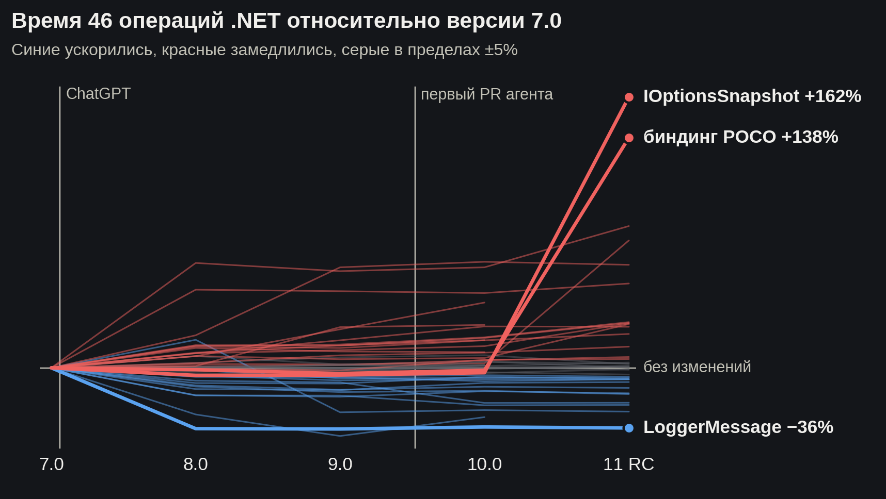
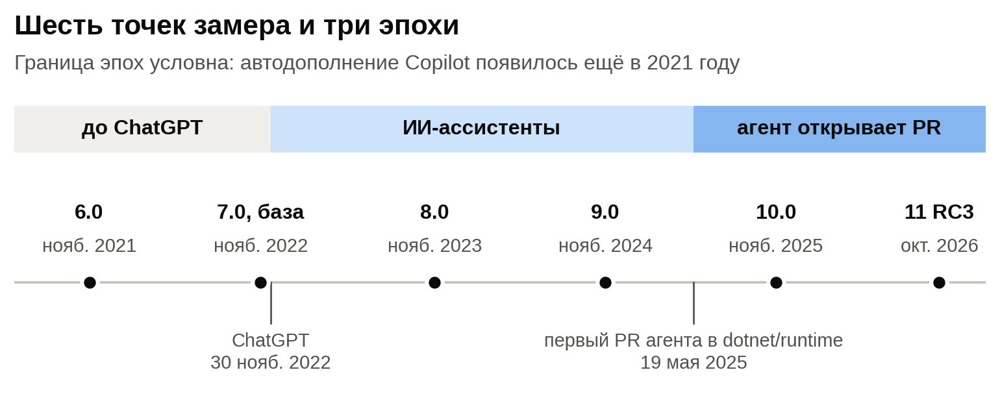
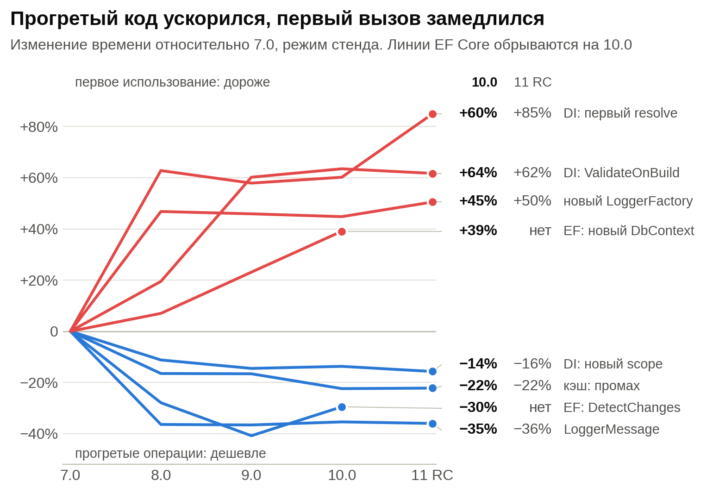
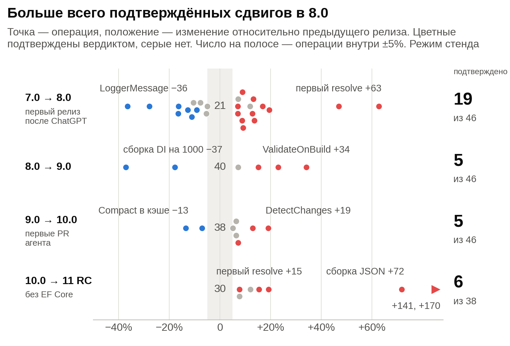
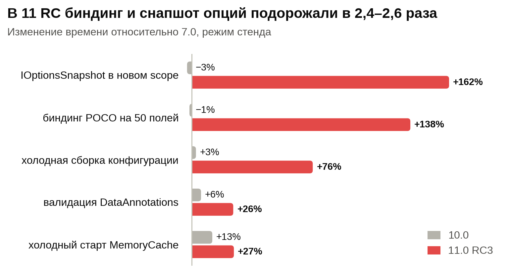
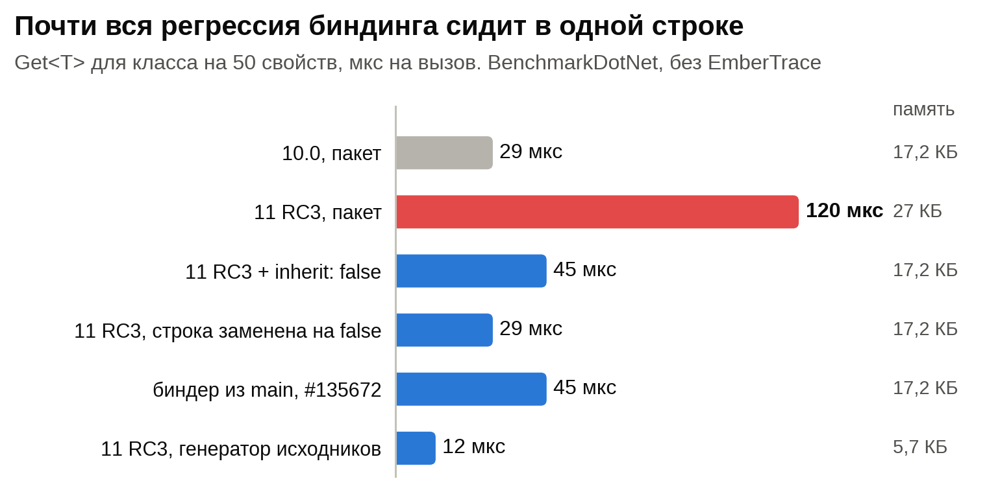
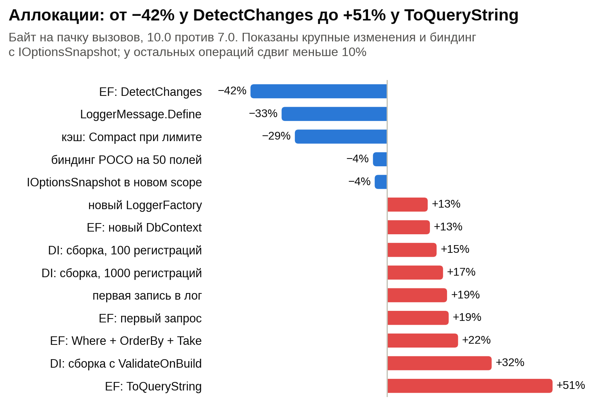
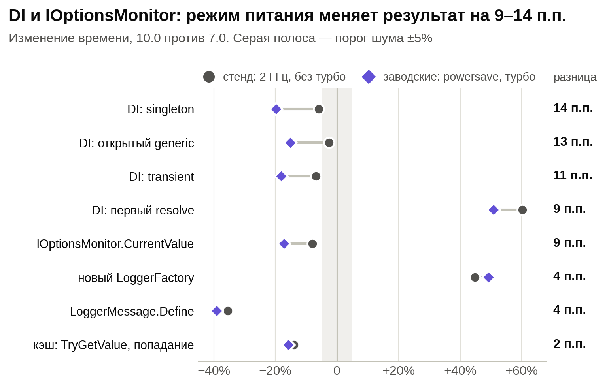

# Стал ли код Microsoft хуже с приходом ИИ: замеры .NET-библиотек от 6.0 до 11 RC



В ноябре 2022 года с разницей в три недели вышли .NET 7 и ChatGPT. Получилась удобная точка отсчёта: последний релиз, написанный до ChatGPT. А в мае 2025 года в dotnet/runtime пришёл Copilot coding agent и к концу октября 2026-го открыл там 1734 pull request'а, 1205 из них смержены.

Портит ли ИИ код, спорить можно долго, а производительность можно просто измерить. Я замерил <abbr title="Dependency Injection, внедрение зависимостей">DI</abbr>, конфигурацию, логирование, кэш и <abbr title="Entity Framework">EF</abbr> Core: 46 операций, шесть мажорных версий, 30 раундов. Заодно по истории Git проверил, кто трогал горячие методы, а две главные просадки в 11 RC проследил до конкретных коммитов. Самую крупную внёс человек одной строкой. Вторую, поменьше, внёс Copilot coding agent, когда чинил дедлок.

<cut />

## Как устроены замеры



Главная ловушка таких сравнений в том, что новый .NET ускоряется ещё и за счёт <abbr title="Just-In-Time, динамический компилятор">JIT</abbr> и <abbr title="Garbage Collector, сборщик мусора">GC</abbr>. Поэтому основной трек фиксирует рантайм на .NET 10.0.11 и меняет только NuGet-пакеты: `Microsoft.Extensions.*` с 6-й по 11-ю версию и EF Core с 6-й по 10-ю (EF Core 11 требует net11.0, поэтому на графиках его линии обрываются на 10.0). Если в процесс загрузилась сборка другой мажорной версии, прогон падает. Всё, что поставляется только вместе с рантаймом (System.Text.Json, Channels, ASP.NET Core), сравнивается отдельно, net10.0 против net11.0, и там разделить библиотеку и рантайм уже нельзя.

Вот один из замеров, `IOptionsSnapshot` в новом scope:

```cs
recorder.Measure(OptionsScopes.Snapshot, 1000, () =>
{
    for (var i = 0; i < 1000; i++)
    {
        using var scope = provider.CreateScope();
        Sink.Keep(scope.ServiceProvider.GetRequiredService<IOptionsSnapshot<Poco50>>().Value);
    }
});
```

Время пишет [EmberTrace](https://github.com/Echways/EmberTrace), мой собственный трейсер, а память считает `GC.GetAllocatedBytesForCurrentThread`. Собственный инструмент здесь риск, к этому вернёмся в разделе об ограничениях. На процесс приходится 20 прогревочных и 200 измеряемых итераций, каждый сценарий живёт в своём процессе и привязан к ядрам 2–5. Всего 30 раундов и 111 процессов на точку, порядок версий в каждом раунде перемешан.

Единица наблюдения — процесс, все раунды весят одинаково. Изменение считается внутри раунда относительно 7.0, доверительный интервал даёт иерархический бутстрэп, значимость — U-критерий Манна — Уитни с поправкой Бенджамини — Хохберга. «Быстрее» или «медленнее» ставится, только если весь 95-процентный интервал лежит за порогом в 5%, ни один раунд не показывает обратного и скорректированное p меньше 0,05. Если весь интервал лежит внутри ±5%, это шум, а всё остальное остаётся без вердикта.

Раунды шли в двух состояниях одного ноутбука (Core i5-12450H, Ubuntu 22.04). «Стенд» — это governor `performance` и выключенный турбобуст, 19 раундов. «Заводские настройки» — `powersave` с турбобустом, 11 раундов. Чем они отличаются и почему это важно, разберём ниже. Если не сказано иное, цифры дальше относятся к стенду.

## Прогретый код ускорился, первый вызов замедлился

Для версии 10.0 против 7.0 итог по 46 операциям такой: 9 быстрее, 13 медленнее, 10 в пределах шума, по 14 вердикта нет. На графике показательные примеры с обеих сторон: повторяющиеся операции к 10.0 потеряли 14–35% времени, а первые вызовы и создание объектов прибавили 39–64%.



В единицах времени это выглядит спокойнее. Значения сняты на ноутбуке с частотой 2 ГГц, так что смотреть стоит на порядок величин:

| Операция | 7.0 | 10.0 |
| --- | --- | --- |
| `LoggerMessage.Define`, один вызов | 377 нс | 244 нс |
| `MemoryCache.TryGetValue`, попадание | 111 нс | 96 нс |
| EF `DetectChanges`, 10 тыс. сущностей | 6,1 мс | 4,3 мс |
| DI, первый resolve графа глубиной 5 | 3,3 мкс | 5,2 мкс |
| Сборка провайдера с `ValidateOnBuild`, 100 регистраций | 40 мкс | 66 мкс |
| Новый `LoggerFactory` | 23 мкс | 34 мкс |
| Новый `DbContext` | 37 мкс | 51 мкс |
| EF, самый первый запрос в процессе | 996 мс | 1162 мс |

Для долгоживущего сервиса такой размен выгоден: логирование выполняется миллионы раз, а провайдер собирается один. Короткоживущим процессам повезло меньше, особенно с EF: первый запрос подорожал на 166 мс, и это уже заметная прибавка к холодному старту. Правда, холодные замеры включают JIT, а старые пакеты работают на новом рантайме, так что у этой строки погрешность выше остальных.

Обе тенденции видны и на заводских настройках, но там раундов меньше, и большинство замедлений первого вызова формально остаётся без вердикта. Уверенно подтверждается только `LoggerFactory`: +49%.

## Перелом случился в 8.0

В споре обычно звучит «до нейросетей было лучше», поэтому посмотрим на шаги между соседними релизами.



Основная перестройка произошла при переходе на 8.0. Правила вердикта здесь те же, только базой служит предыдущий релиз: подтверждается 19 сдвигов из 46 на шаге к 8.0, по 5 на шагах к 9.0 и 10.0 и 6 из 38 на шаге к 11 RC. Шаг к 10.0 на фоне предыдущего не выделяется, правда, агент застал только последние полгода его разработки.

На заводских настройках 8.0 так не выделяется (8, 7, 5 и 6): там всего 11 раундов, и интервалы в разы шире. Зато шаг к 11 RC совпадает. В обоих режимах подтверждено по 6 сдвигов, и 5 операций из 6 общие.

К самому переходу на 8.0 есть возражение. Каждая мажорная версия пакета приносит свою сборку: `lib/net7.0` у 7.x, `lib/net8.0` у 8.x, хотя рантайм везде .NET 10. Значит, в шаг входят и ветки условной компиляции, которых старая сборка не видит даже на новом рантайме. Это тоже код библиотеки, но разделить правки и смену целевого фреймворка такой дизайн не позволяет.

В шаге к 10.0 примечательны три операции. `new DbContext` подорожал на 13%, `Compact` в кэше подешевел на 13%, а `DetectChanges` стал на 19% медленнее, чем в 9.0, и отдал часть выигрыша: относительно 7.0 было −41%, стало −30%.

То, что самый крупный сдвиг случился в первом релизе после ChatGPT, ничего не говорит об участии ИИ: по замерам видно, что и когда поменялось, но причин они не объясняют.

## Агент: до 10.0 в горячих методах его нет, в 11.0 он там появился

Каждый коммит между тегами `v7.0.20` и `v10.0.14` сопоставлен с его pull request'ом. Агента легко опознать: PR открывает GitHub-приложение `copilot-swe-agent` с id 198982749, а в squash-коммитах остаётся трейлер `Co-authored-by`. В DI и `Caching.Memory` нашлось вот что:

- 113 коммитов: 57 от участников организации, условно Microsoft, 56 от сообщества, от агента ни одного, соавторских с агентом тоже ни одного;
- 24 горячих метода, прослеженных через `git log -L`: 39 правок, агентских среди них нет, а 8 методов между этими тегами не менялись вообще;
- 6 PR с меткой `tenet-performance`, все написаны людьми, пять из них — внешними контрибьюторами.

Запланированное сравнение «методы, которые трогал агент, против методов, которые трогали только люди» на этом окне провести не получилось: первая группа пуста. Но окно заканчивалось на 10.0, а полный цикл разработки у агента был только в 11.0. Поэтому я дотянул разметку до RC3 и добавил остальные библиотеки. Здесь считается только git, автор коммита, без разбивки на Microsoft и сообщество:

| Библиотека | 7.0 → 10.0, коммитов | из них агент | 10.0 → 11 RC, коммитов | из них агент |
| --- | --- | --- | --- | --- |
| DI | 80 | 0 | 21 | 11 |
| Кэш | 33 | 0 | 14 | 1 |
| Конфигурация | 67 | 0 | 15 | 1 |
| Options | 37 | 0 | 7 | 0 |
| Логирование | 52 | 1 | 8 | 3 |
| EF Core | 867 | 29 | 256 | 73 |

Часть агентских коммитов в DI — документация и аннотации, но не все: из 11 правок горячих методов DI и кэша в новом окне 3 принадлежат агенту. Ещё в 5 коммитах конфигурации и Options есть соавтор Copilot CLI.

Границы у этой таблицы такие:

- На реальную причастность я проверил только биндер и DI, про них ниже. EF Core просто посчитан, хотя там и больше всего правок агента, и самый большой шаг к 10.0.
- Метка `cca` значит «PR открыт агентом», а не «написано без человека»: такие PR проходят ревью и вливаются людьми. Ассистент в IDE вообще не оставляет следов в Git, так что об эпохе ассистентов данные ничего сказать не могут.
- Граница эпох условна. Автодополнение Copilot появилось ещё в 2021 году, так что и 7.0 мог писаться не совсем без ИИ.
- Деление на Microsoft и сообщество грубое. В 24 коммитах из 113 `author_association` расходится с почтой на `@microsoft.com`.

## Самая крупная просадка в 11 RC сидит в одной строке



Биндинг <abbr title="Plain Old CLR Object, простой класс с данными">POCO</abbr> на 50 полей подорожал с 61 до 145 мкс, `IOptionsSnapshot` в новом scope — с 52 до 136 мкс. Аллокации у обеих операций выросли почти одинаково, примерно на 10 КБ на вызов. На заводских настройках картина та же: +134% и +158%.

Прибавка в 10 КБ на 50 свойств подсказывает, что платим за каждое свойство. В `ConfigurationBinder.cs` между 10.0 и RC3 всего 7 коммитов, и один из них, [#126396](https://github.com/dotnet/runtime/pull/126396) с новым атрибутом `[ConfigurationIgnore]`, добавляет как раз такую проверку:

```cs
private static bool IsIgnoredProperty(PropertyInfo property) =>
    property.IsDefined(typeof(ConfigurationIgnoreAttribute));
```

Она выполняется для каждого свойства при каждом биндинге. Чтобы проверить догадку, я собрал биндер из исходников RC3 с заменой этого выражения на `false` и подменил одну DLL рядом с тем же стендом. Те же сценарии, 6 раундов, режим стенда:

| Операция | 10.0 | 11 RC | 11 RC, строка заменена |
| --- | --- | --- | --- |
| Биндинг POCO | 61 мкс | 148 мкс | 60 мкс |
| `IOptionsSnapshot` в новом scope | 51 мкс | 139 мкс | 53 мкс |
| Валидация DataAnnotations | 43 мкс | 53 мкс | 43 мкс |
| Аллокации биндинга на вызов | 18,4 КБ | 28,4 КБ | 18,4 КБ |

Одна строка объясняет сразу три из шести подтверждённых сдвигов этого шага. Холодную сборку конфигурации (+76%) она не лечит, причина там другая и пока не найдена. Отдельно я проверил это в BenchmarkDotNet, без моего трейсера, на минимальном примере:



Основную цену даёт перегрузка-расширение: у неё по умолчанию `inherit: true`. С `inherit: false` время падает со 120 до 45 мкс, а аллокации возвращаются к уровню 10.0. Именно так написано в `main` после [#135672](https://github.com/dotnet/runtime/pull/135672), но тот PR чинит другую ошибку и в ветку `release/11.0` не попал. Я завёл [issue #136759](https://github.com/dotnet/runtime/issues/136759) с примером и этими цифрами. Лаборатория производительности .NET этого, похоже, не видит: [её бенчмарк биндинга](https://github.com/dotnet/performance/blob/main/src/benchmarks/micro/libraries/Microsoft.Extensions.Configuration/ConfigurationBinderBenchmarks.cs) использует класс с одним свойством.

Кто виноват? PR открыт участником организации, следов Copilot в коммите нет, а фича делалась по одобренному API-запросу. Следов ИИ нет, что не доказывает его отсутствия: ассистент в IDE в Git не виден.

Если вы уже на RC, обход есть: генератор исходников (`EnableConfigurationBindingGenerator`) в том же примере даёт 12 мкс и 5,7 КБ. `IOptionsSnapshot` пересоздаёт опции на каждый scope намеренно, и ещё в 2021 году Дэвид Фаулер [назвал его ловушкой производительности](https://github.com/dotnet/runtime/issues/53793). Там, где не нужно обновление конфигурации в рамках запроса, `IOptionsMonitor` дешевле и без этой регрессии.

Оговорки: это релиз-кандидат, а в основном треке работает сборка `net10.0` из исходников 11.0 на рантайме .NET 10, так что на настоящем net11.0 цифры могут отличаться.

## Вторая просадка внёс агент, и это размен

`DI: первый resolve` на шаге к 11 RC вырос ещё на 15%. Здесь агент действительно рядом: в DI у него 11 коммитов из 21, поэтому я собрал DI из исходников по коммитам и прогнал бисект, 8 раундов на вариант. Скачок появляется ровно на одном коммите:

| Сборка DI | Первый resolve, 100 провайдеров |
| --- | --- |
| 10.0, пакет | 0,565 мс |
| Коммит перед #124331 | 0,554 мс |
| [#124331](https://github.com/dotnet/runtime/pull/124331), PR агента | 0,641 мс |
| 11 RC3, пакет | 0,653 мс |
| 11 RC3 с откатом только #124331 | 0,569 мс |

Внутри раунда коммит даёт +16,5% (95% интервал 14,3–18,8, все 8 раундов в одну сторону), а откат на RC3 возвращает к уровню 10.0: разница +1,9%, интервал включает ноль. На холодном resolve аллокации растут с 8848 до 9080 байт. Прогретые `singleton`, `scoped` и сборку провайдера коммит не задевает.

Этот PR чинит [дедлок](https://github.com/dotnet/runtime/issues/88390) при циклических зависимостях через фабрики. Теперь `VisitRootCache` ведёт `[ThreadStatic] HashSet` тех, кого сейчас резолвит поток. Цена — примерно 0,9 мкс на первый resolve в новом провайдере, и за исправленный дедлок это разумная плата. PR прошёл ревью и влит людьми.

Заметьте ещё одну вещь: в моём списке из 24 горячих методов `VisitRootCache` не было, так что разметка по методам этот случай пропустила. Нашёл его только бисект. Остальные агентские правки горячих методов, например переписанный выбор конструктора, на этот сценарий не влияют: там конструктор один. Другие сценарии я так не проверял.

Во втором треке (net10.0 против net11.0, библиотека и рантайм вместе) есть и хорошие новости: Kestrel стартует на 54% быстрее, холодное подключение EF с созданием схемы ускорилось на 15–17%. `DetectChanges` там, наоборот, медленнее на 11–12%. Время обработки запроса в ASP.NET Core выросло на 81–90%, но верить этому пока рано: распределение многомодальное, встроенный генератор нагрузки работает с фиксированной частотой, bombardier не запускался. Нужен второй инструмент.

## Чем всё это снято

[EmberTrace](https://github.com/Echways/EmberTrace) — мой трейсер для .NET с открытой лицензией MIT, [пакет есть на NuGet](https://www.nuget.org/packages/EmberTrace). Я его автор, поэтому считайте этот раздел рекламой, но с цифрами. Все основные замеры статьи — это один скоп на пачку вызовов, как в примере в начале: процессов сотни, каждый оставляет файл `.ember`, а сравнение строится уже по файлам.

Трейсер сам виновника не назвал: сдвиг показали замеры, подозреваемого дал `git log`, а доказала подмена DLL. Зато скоп можно поставить прямо внутрь чужого кода и посмотреть, куда уходит время. Я добавил четыре скопа в исходники биндера:

```cs
private static bool IsIgnoredProperty(PropertyInfo property)
{
    using var scope = Tracer.Scope(Tracer.Id("ConfigurationBinder.IsIgnoredProperty"));
    return property.IsDefined(typeof(ConfigurationIgnoreAttribute));
}
```

Вот отчёт `TraceText.Write` за 20 пачек по 1000 биндингов:

```text
Name                                   Count    Incl ms   Excl ms   Excl%
bind.x1k                               20       2958.218  192.096   6.44
ConfigurationBinder.BindProperties     20000    2766.122  356.338   11.95
ConfigurationBinder.IsIgnoredProperty  1000000  1813.144  1813.144  60.80
ConfigurationBinder.BindProperty       1000000  551.475   551.475   18.49
ConfigurationBinder.GetAllProperties   20000    45.165    45.165    1.51
```

Миллион вызовов и 61% времени на проверку атрибута, которого в этом классе нет. За 3 секунды записано 4 млн событий, ни одно не потеряно. Даром это не даётся: со скопами биндинг занял 148 мкс против 120 мкс в бенчмарке, то есть грубо 0,3 мкс на скоп вместе с хешированием имени в `Tracer.Id`, так что доли здесь приблизительные. Для такой разовой диагностики это приемлемо, а скоп на каждый вызов в продакшене я бы ставить не стал.

Кроме этого, в EmberTrace есть асинхронные потоки, flight recorder, инструментирование через `[Trace]` и экспорт в Chrome Trace, Perfetto и OpenTelemetry, но в этой статье они не использовались. Скрипты для повторения обоих поисков лежат в [`experiments/`](https://github.com/Echways/embertrace-on-microsoft-report/tree/main/experiments).

## Аллокации надёжнее времени

Байты на пачку почти детерминированы и от частоты не зависят, поэтому это самый надёжный сигнал в наборе.



Часто память и время идут вместе: у `LoggerMessage` и `DetectChanges` меньше и того и другого, у `ValidateOnBuild` и `DbContext` больше. Но бывает и иначе. `Where + OrderBy + Take` в EF аллоцирует на 22% больше при времени в пределах шума (+1,7%): в приложении это, скорее всего, вылезет позже как лишняя работа GC. А сборка DI-провайдера на 1000 регистраций требует на 17% больше памяти, хотя её среднее время упало на 25%.

Код при этом растёт. Между 7.0 и 11 RC код DI вырос на 25%, `Caching.Memory` на 24%, `DI.Abstractions` на 129%, причём у последней основной скачок приходится на 8.0, где появились keyed services. Средняя цикломатическая сложность почти не сдвинулась, она держится в диапазоне 1,3–2,5, так что по средним всё спокойно. Но максимальная сложность метода в DI выросла с 14 до 23, а в `DI.Abstractions` с 10 до 26.

## «Настроенный» стенд оказался почти вдвое медленнее

Рекомендация для бенчмарков стандартная: зафиксируй частоту, выключи турбобуст. На этом процессоре `no_turbo` ограничивает ядра базовыми 2 ГГц при максимуме 4,4 ГГц. В результате на заводских настройках все 46 операций базовой версии выполняются в 1,6–2,1 раза быстрее, чем на «правильном» стенде.

Ладно бы менялись только абсолютные числа, но меняются и относительные:



Операции DI и `IOptionsMonitor` в 10.0 показывают ускорение на 3–8% на стенде и на 15–20% на заводских настройках. Для singleton, transient и open generic это разница между «вердикта нет» и «уверенно быстрее», хотя версия кода та же самая. Правдоподобное объяснение — другое соотношение частоты ядра и скорости памяти, но оно не проверялось.

Списать всё на дрейф нельзя: раунды стенда идут и до, и после блока с заводскими настройками. Сравнение режимов находит значимую разницу в 29 случаях из 252, а сравнение первых и последних раундов стенда между собой — в одном. Дизайн при этом неидеален: заводские раунды идут одним блоком, процессов в них меньше (33 против 78).

Поэтому ±5%, полученные на одном ноутбуке в одном режиме питания, почти ничего не значат. Если сравниваете версии, указывайте режим, а лучше мерьте в двух.

## Где всё это может оказаться неверным

- Перекрёстная проверка пока частичная. BenchmarkDotNet прогнан только на двух операциях, по разу на версию: биндинг 54, 50 и 138 мкс для 7.0, 10.0 и RC, снапшот 56, 51 и 143 мкс. Регрессию он подтверждает, отношение RC к 10.0 у него 2,8 против 2,4–2,7 у EmberTrace. На малых сдвигах расхождение заметнее: 10.0 против 7.0 даёт −8% и −9% против −1% и −3%. Для остальных 44 операций искажения от трейсера не оценены. Контрольного прогона без tiered compilation тоже нет.
- Правила вердикта ужесточены после первых раундов. Исходное правило сохранено в данных, отклонение задокументировано, но это всё равно решение, принятое после просмотра данных.
- Это ноутбук: гибридный процессор, без изоляции ядер, средняя нагрузка в основном 1–2,7. Доказательством служат отношения внутри раунда, а не абсолютные времена.
- Метрика иногда решает знак. У `cache.set` и `get-or-create` в 10.0 медиана показывает рост на 22–31%, а среднее — падение на 5–9%. Причина двух мод не установлена, поэтому заголовков на этих операциях строить нельзя.
- Это синтетика. Измерены только API, которые есть во всех версиях, а значит, самые новые быстрые пути в сравнение не попали. Старые пакеты работают на новом рантайме и могут не использовать его оптимизации.
- Пять семейств библиотек — ещё не весь код Microsoft.

## Что в итоге

Обновляться с 7.0, которая и так вне поддержки, имеет смысл и ради горячих путей: выигрыш там реальный. Если у вас serverless или короткоживущие утилиты, цену холодного старта лучше измерить самим. Перед переходом на 11.0 стоит прогнать свои сценарии с биндингом конфигурации и `IOptionsSnapshot`, причём на финальной версии, а не на RC, и посмотреть, чем закончится [#136759](https://github.com/dotnet/runtime/issues/136759).

На исходный вопрос ответ теперь такой: в измеренном нет признаков того, что код стал хуже из-за ИИ, но и доказательства обратного нет. До 10.0 агента в горячих методах DI и кэша просто не было. В 11.0 он там есть, и единственная его правка, которую я поймал на замерах, стоит 0,9 мкс на первый resolve в обмен на исправленный дедлок. Самая дорогая регрессия релиза — одна строка в PR человека, ради новой фичи.

Открытым остаётся многое: EF Core, где правок агента больше всего, холодная сборка конфигурации и то, сколько из этого изменится к финальному релизу.

Код стенда и методика: [embertrace-on-microsoft-report](https://github.com/Echways/embertrace-on-microsoft-report).
