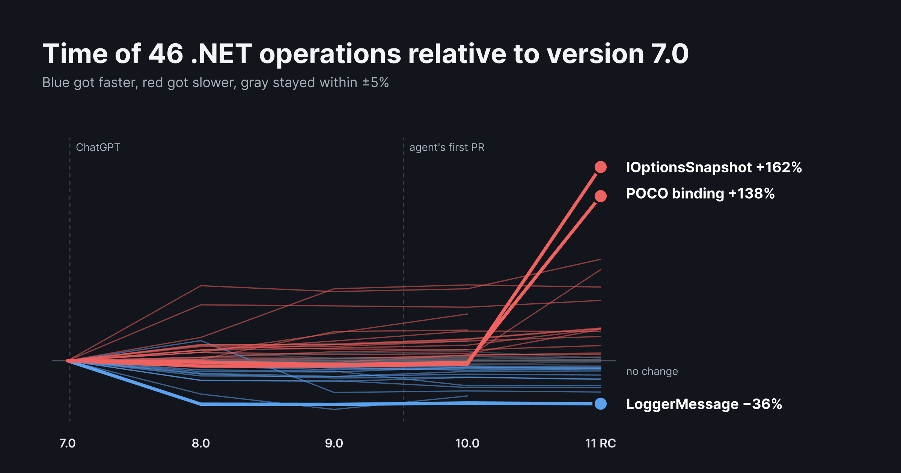
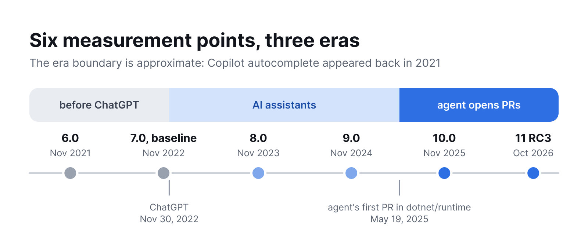
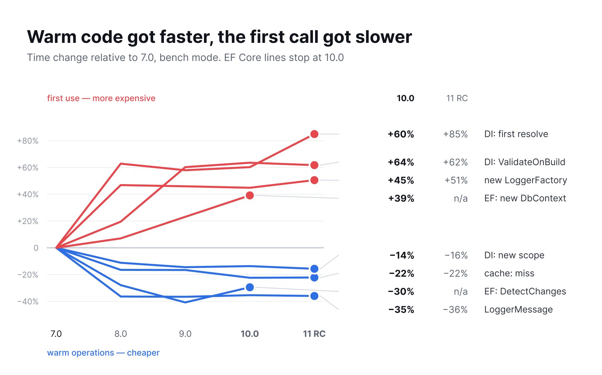
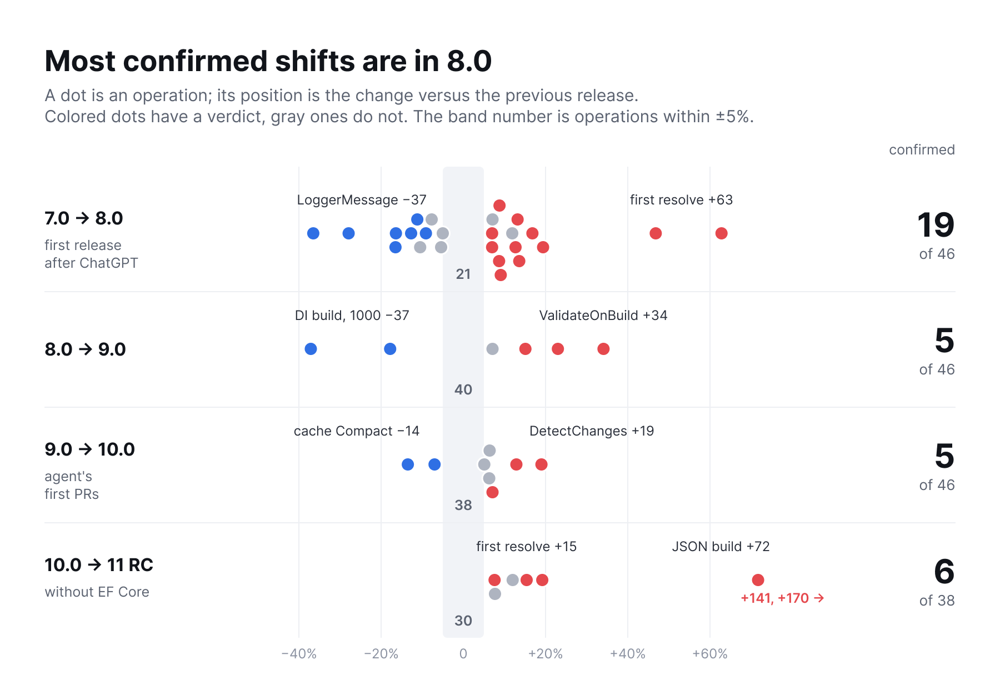
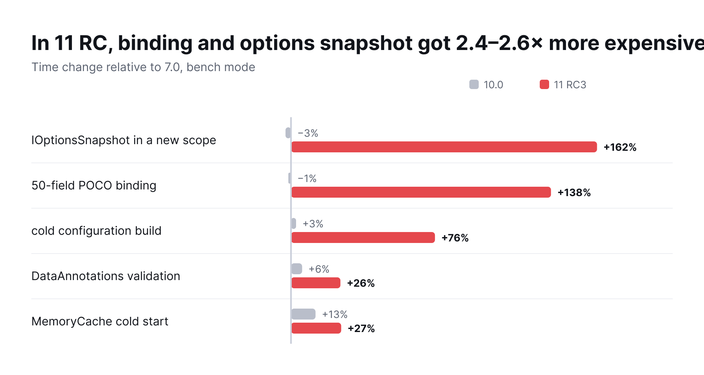
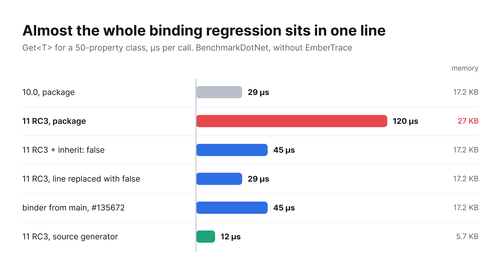
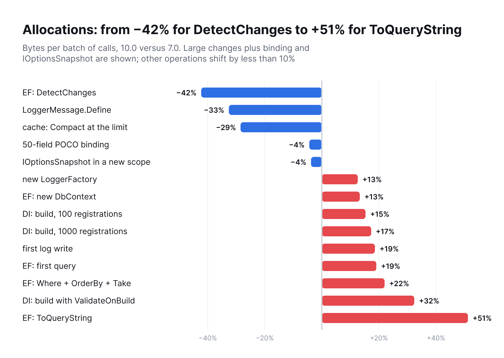
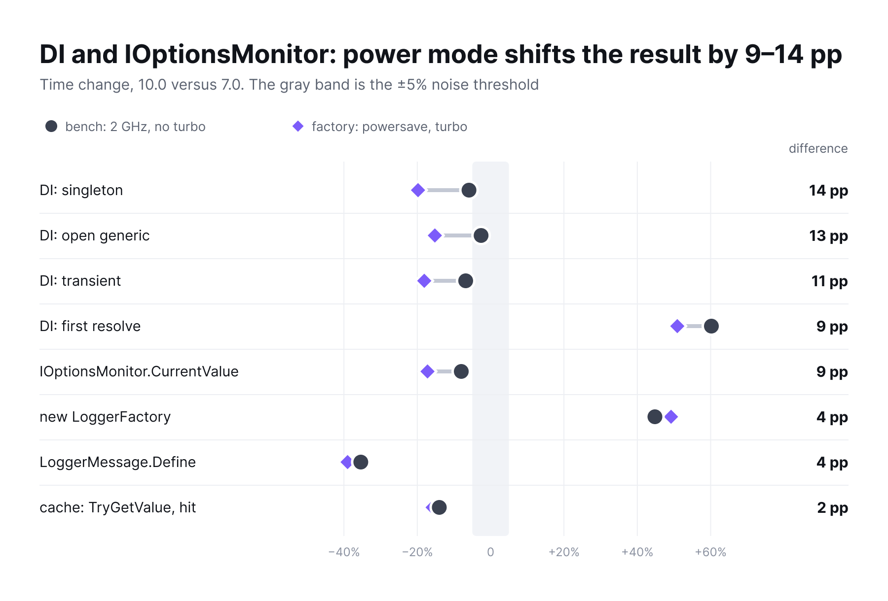

# Has Microsoft's code gotten worse since AI arrived: measuring .NET libraries from 6.0 to 11 RC



In November 2022, .NET 7 and ChatGPT were released three weeks apart. That makes a convenient reference point: .NET 7 was the last release written before ChatGPT. Then in May 2025 the Copilot coding agent arrived in dotnet/runtime, and by the end of October 2026 it had opened 1734 pull requests there, 1205 of them merged.

You can argue for a long time about whether AI ruins code, but performance can simply be measured. I measured dependency injection (DI), configuration, logging, caching and Entity Framework (EF) Core: 46 operations, six major versions, 30 rounds. I also used the Git history to check who touched the hot methods, and traced two regressions in 11 RC to specific commits. The biggest one was introduced by a human with a single line. The second, smaller one came with a PR from the Copilot coding agent that was fixing a deadlock.

## How the measurements work



New .NET versions also get faster thanks to the JIT compiler and the garbage collector (GC). So the main track pins the runtime to .NET 10.0.11 and changes only the NuGet packages: `Microsoft.Extensions.*` from version 6 to 11 and EF Core from version 6 to 10 (EF Core 11 requires net11.0, so its lines stop at 10.0 on the charts). If an assembly of a different major version gets loaded into the process, the run fails. Libraries that ship inside the framework itself (System.Text.Json, Channels, ASP.NET Core) can't be swapped this way: an old package loses to the built-in assembly. I compare those, along with EF Core 11, separately, net10.0 against net11.0, and there the library can no longer be separated from the runtime.

Here is one of the measurements, `IOptionsSnapshot` in a new scope:

```cs
recorder.Measure(OptionsScopes.Snapshot, 1000, () =>
{
    for (var i = 0; i < 1000; i++)
    {
        using var scope = provider.CreateScope();
        Sink.Keep(scope.ServiceProvider.GetRequiredService<IOptionsSnapshot<Poco50>>().Value);
    }
});
```

Time is recorded by [EmberTrace](https://github.com/Echways/EmberTrace), and memory is counted with `GC.GetAllocatedBytesForCurrentThread`. Each process gets 20 warm-up and 200 measured iterations, and every scenario runs in its own process pinned to logical cores 2–5. In total that is 30 rounds and 111 processes for each version–scenario pair, with the order of versions shuffled in every round.

The unit of observation is the process, and all rounds carry equal weight. The change is computed within a round relative to 7.0, the confidence interval comes from a hierarchical bootstrap, and significance from the Mann–Whitney U test with Benjamini–Hochberg correction. "Faster" or "slower" is assigned only if the whole 95% interval lies beyond a 5% threshold, no round shows the opposite, and the adjusted p is below 0.05. If the whole interval lies within ±5%, it is noise, and everything else is left without a verdict.

The rounds ran in two states of the same laptop (Core i5-12450H, Ubuntu 22.04). "Bench" is the `performance` governor with turbo boost off, 19 rounds. "Factory settings" is `powersave` with turbo boost on, 11 rounds. Why this matters is covered below. Unless stated otherwise, the numbers that follow refer to the bench.

## Warm code got faster, the first call got slower

For 10.0 versus 7.0 the tally over 46 operations is: 9 faster, 13 slower, 10 within noise, 14 without a verdict. The chart shows representative examples from both sides: repeated operations got 14–35% faster by 10.0, while first calls and object creation got 39–64% slower.



In units of time it looks calmer. The values were taken on a laptop running at 2 GHz, so look at the order of magnitude:

| Operation | 7.0 | 10.0 |
| --- | --- | --- |
| `LoggerMessage.Define`, one call | 377 ns | 244 ns |
| `MemoryCache.TryGetValue`, hit | 111 ns | 96 ns |
| EF `DetectChanges`, 10k entities | 6.1 ms | 4.3 ms |
| DI, first resolve of a graph of depth 5 | 3.3 µs | 5.2 µs |
| Provider build with `ValidateOnBuild`, 100 registrations | 40 µs | 66 µs |
| New `LoggerFactory` | 23 µs | 34 µs |
| New `DbContext` | 37 µs | 51 µs |
| EF, the very first query in the process | 996 ms | 1162 ms |

For a long-running service this trade is a good one: logging runs millions of times, while the provider is built once. Short-lived processes fare worse, especially with EF: the first query got 166 ms more expensive, which is a noticeable addition to a cold start. True, cold measurements include the JIT, and the old packages run on the new runtime, so the error on this row is larger than on the others.

Both trends are also visible on factory settings, but there are fewer rounds, and most first-call slowdowns formally remain without a verdict. Only `LoggerFactory` is confirmed with confidence: +49%.

## The biggest change was in 8.0

The debate usually goes "it was better before neural networks", so let's look at the steps between adjacent releases.



The verdict rules here are the same, only the baseline is the previous release: 19 of 46 shifts are confirmed on the step to 8.0, 5 each on the steps to 9.0 and 10.0, and 6 of 38 on the step to 11 RC. The step to 10.0 doesn't stand out, although the agent only caught the last half year of its development.

On factory settings 8.0 doesn't stand out like that (8, 7, 5 and 6): there are only 11 rounds, and the intervals are several times wider. But the step to 11 RC matches. Both modes confirm 6 shifts, and 5 of the 6 operations are shared.

There is an objection to the jump to 8.0 itself. Each major package version brings its own assembly: `lib/net7.0` for 7.x, `lib/net8.0` for 8.x, even though the runtime is .NET 10 everywhere. That means the step also includes conditional-compilation branches that the old assembly can't see even on the new runtime. That is library code too, but this design can't separate the code changes from the change of target framework.

Three operations stand out on the step to 10.0. `new DbContext` got 13% more expensive, `Compact` in the cache got 13% cheaper, and `DetectChanges` became 19% slower than in 9.0, giving back part of its gain: relative to 7.0 it was −41%, now −30%.

The fact that the largest shift happened in the first release after ChatGPT says nothing about AI involvement: the measurements show what changed and when, but not why.

## The agent: absent from hot DI and cache methods up to 10.0, present in 11.0

Every commit to DI and `Caching.Memory` between the tags `v7.0.20` and `v10.0.14` has been matched to its pull request. The agent is easy to identify: its PRs are opened by the GitHub app `copilot-swe-agent` with id 198982749, and squash commits keep a `Co-authored-by` trailer. Here is what turned up:

- 113 commits: 57 from organization members (loosely, Microsoft), 56 from the community, none from the agent and none co-authored with the agent;
- 24 hot methods traced through `git log -L`: 39 edits, none of them by the agent, and 8 methods did not change at all between these tags;
- 6 PRs labeled `tenet-performance`, all written by humans.

The planned comparison "methods the agent touched versus methods only humans touched" couldn't be done on this window: the first group is empty. But the window ended at 10.0, and the agent only had a full development cycle in 11.0. So I extended the labeling to RC3 and added the other libraries. Here only the Git commit author is counted, with no Microsoft/community split:

| Library | 7.0 → 10.0, commits | of which agent | 10.0 → 11 RC, commits | of which agent |
| --- | --- | --- | --- | --- |
| DI | 80 | 0 | 21 | 11 |
| Cache | 33 | 0 | 14 | 1 |
| Configuration | 67 | 0 | 15 | 1 |
| Options | 37 | 0 | 7 | 0 |
| Logging | 52 | 1 | 8 | 3 |
| EF Core | 867 | 29 | 256 | 73 |

Some of the agent's commits in DI are documentation and annotations, but not all: of the 11 edits to hot DI and cache methods in the new window, 3 belong to the agent. Another 5 commits in configuration and Options have Copilot CLI as a co-author.

Caveats for the table:

- I checked actual involvement only for the binder and DI, covered below. EF Core was only counted, even though it has the most agent edits, and on the step to 10.0 its `DbContext` and `DetectChanges` shifted noticeably.
- An agent commit means "PR opened by the agent", not "written without a human": such PRs are reviewed and merged by people. An IDE assistant leaves no trace in Git at all, so the data can say nothing about the assistant era.
- The boundary between eras is conditional. Copilot autocomplete appeared back in 2021, so 7.0 may not have been written entirely without AI either.
- The Microsoft/community split is rough: it relies on the `author_association` field, and employees with hidden organization membership end up in the community. In 24 of the 113 commits this field disagrees with an `@microsoft.com` email.

## The biggest regression in 11 RC sits in one line



Relative to 7.0, binding a 50-field plain old CLR object (POCO) got more expensive from 61 to 145 µs, and `IOptionsSnapshot` in a new scope from 52 to 136 µs. Allocations of both operations grew almost equally, by about 10 KB per call. On factory settings the picture is the same: +134% and +158%.

An extra 10 KB over 50 properties suggests we are paying per property. `ConfigurationBinder.cs` has only 7 commits between 10.0 and RC3, and one of them, [#126396](https://github.com/dotnet/runtime/pull/126396) with the new `[ConfigurationIgnore]` attribute, adds exactly such a check:

```cs
private static bool IsIgnoredProperty(PropertyInfo property) =>
    property.IsDefined(typeof(ConfigurationIgnoreAttribute));
```

It runs for every property on every binding. To test the hunch, I built the binder from the RC3 sources with this expression replaced by `false` and swapped a single DLL in the already built bench. Same scenarios, 6 rounds, bench mode:

| Operation | 10.0 | 11 RC | 11 RC, line replaced |
| --- | --- | --- | --- |
| POCO binding | 61 µs | 148 µs | 60 µs |
| `IOptionsSnapshot` in a new scope | 51 µs | 139 µs | 53 µs |
| DataAnnotations validation | 43 µs | 53 µs | 43 µs |
| Binding allocations per call | 18.4 KB | 28.4 KB | 18.4 KB |

One line explains three of the six confirmed shifts of this step at once. It doesn't cure the cold configuration build (+76%); the cause there is different and hasn't been found yet. Separately, I checked this in BenchmarkDotNet, without my tracer, on a minimal example:



Most of the cost comes from the extension overload: its default is `inherit: true`. With `inherit: false` the time drops from 120 to 45 µs, and allocations return to the 10.0 level. That is exactly how it is written in `main` after [#135672](https://github.com/dotnet/runtime/pull/135672), but that PR fixes a different bug and did not make it into the `release/11.0` branch. I filed [issue #136759](https://github.com/dotnet/runtime/issues/136759) with an example and these numbers. The dotnet/performance benchmarks apparently don't catch this: [their binding test](https://github.com/dotnet/performance/blob/main/src/benchmarks/micro/libraries/Microsoft.Extensions.Configuration/ConfigurationBinderBenchmarks.cs) uses a class with a single property.

A maintainer replied the same day. They acknowledged the regression (the issue got the `regression-from-last-release` label) but said plainly that performance of the reflection-based binder is not a top priority, and the source generator is the recommended route for hot paths. They promised to mitigate most of the regression on `main` and propose a fix for backporting to 11.0, and called `IOptionsSnapshot` a separate problem already discussed in [#53793](https://github.com/dotnet/runtime/issues/53793). A [draft PR #136899](https://github.com/dotnet/runtime/pull/136899) followed: it checks the virtual-slot flags of the getter and setter and uses the cheap non-inheriting attribute lookup when the property cannot be overridden. By the author's numbers, `Get<T>` on 50 properties takes 10.3 µs versus 27.6 µs on the affected build and 9.4 µs on the 10.0 binder, and allocations return to 17.5 KB. About 10–15% over 10.0 remains, so the per-type caching I suggested is neither replaced nor included. At the time of writing the PR is not merged and has no reviews, so whether the fix lands in 11.0 is still unknown. The milestone hints at the same: the issue is tied to 12.0.0, not 11.0, so the backport is promised but not guaranteed.

The PR was opened by an organization member, the feature was built from an approved API proposal, and there are no Copilot traces in the commit. This doesn't prove that AI wasn't used: an IDE assistant is invisible in Git.

If you are already on RC, there is a workaround: the source generator (`EnableConfigurationBindingGenerator`) gives 12 µs and 5.7 KB on the same example, faster than both 10.0 (29 µs) and any variant of the reflection-based binder. It is also what the maintainers recommend for performance-sensitive scenarios, so don't count on the reflection path closing the gap completely. `IOptionsSnapshot` recreates options for every scope by design, and back in 2021 David Fowler [called it a performance trap](https://github.com/dotnet/runtime/issues/53793). Where you don't need configuration reloading within a request, `IOptionsMonitor` is cheaper and free of this regression.

A caveat: this is a release candidate, and the main track runs a `net10.0` build from the 11.0 sources on the .NET 10 runtime, so on a real net11.0 the numbers may differ.

## Another regression was introduced by the agent, and it's a trade-off

The first resolve in DI grew by another 15% on the step to 11 RC. Here the agent really is nearby: in DI it has 11 commits out of 21, so I built DI from source by commit and ran a bisect, 8 rounds per variant. The jump appears at exactly one commit:

| DI build | First resolve, 100 providers |
| --- | --- |
| 10.0, package | 0.565 ms |
| Commit before #124331 | 0.554 ms |
| [#124331](https://github.com/dotnet/runtime/pull/124331), agent PR | 0.641 ms |
| 11 RC3, package | 0.653 ms |
| 11 RC3 with only #124331 reverted | 0.569 ms |

Within a round the commit adds +16.5% (95% interval 14.3–18.8, all 8 rounds in the same direction), and reverting it on RC3 brings things back to the 10.0 level: the difference is +1.9%, the interval includes zero. On a cold resolve, allocations grow from 8848 to 9080 bytes. Warm `singleton`, `scoped` and provider build are not affected by the commit.

This PR fixes a [deadlock](https://github.com/dotnet/runtime/issues/88390) with circular dependencies through factories. `VisitRootCache` now keeps a `[ThreadStatic] HashSet` of whatever the thread is currently resolving. The cost is about 0.9 µs per first resolve in a new provider, which is a reasonable price for a fixed deadlock. The PR was reviewed and merged by humans.

`VisitRootCache` wasn't in my list of 24 hot methods, so the per-method labeling missed this case, and only the bisect found it. The agent's other edits to hot methods, such as the rewritten constructor selection, don't affect this scenario: there is only one constructor there. I haven't checked other scenarios this way.

## Second track: net10.0 versus net11.0

Here the library and runtime change together, and there is good news: Kestrel starts 54% faster, and EF cold connect with schema creation got 15–17% faster. `DetectChanges`, on the other hand, is 11–12% slower there. ASP.NET Core request handling time grew by 81–90%, but I don't believe that number yet: the distribution is multimodal, the built-in load generator works at a fixed rate, and bombardier wasn't run.

## What it was all measured with

[EmberTrace](https://github.com/Echways/EmberTrace) is my tracer for .NET under the MIT license, and the [package is on NuGet](https://www.nuget.org/packages/EmberTrace). All the main measurements in the article use one scope per batch of calls, as in the example at the start: there are thousands of processes, each leaves an `.ember` file, and the comparison is built from the files.

The tracer itself didn't name the culprit: the measurements showed the shift, `git log` found the suspect, and the DLL swap confirmed it. But a scope can be placed right inside someone else's code to see where the time goes. I added four scopes to the binder sources:

```cs
private static bool IsIgnoredProperty(PropertyInfo property)
{
    using var scope = Tracer.Scope(Tracer.Id("ConfigurationBinder.IsIgnoredProperty"));
    return property.IsDefined(typeof(ConfigurationIgnoreAttribute));
}
```

Here is the `TraceText.Write` report for 20 batches of 1000 bindings:

```text
Name                                   Count    Incl ms   Excl ms   Excl%
bind.x1k                               20       2958.218  192.096   6.44
ConfigurationBinder.BindProperties     20000    2766.122  356.338   11.95
ConfigurationBinder.IsIgnoredProperty  1000000  1813.144  1813.144  60.80
ConfigurationBinder.BindProperty       1000000  551.475   551.475   18.49
ConfigurationBinder.GetAllProperties   20000    45.165    45.165    1.51
```

A million calls and 61% of the time spent checking for an attribute that this class doesn't have. In 3 seconds 4 million events were recorded, none lost. This has a cost: with scopes the binding took 148 µs versus 120 µs in the benchmark, which is roughly 0.3 µs per scope including the name hashing in `Tracer.Id`, so the shares here are approximate. For one-off diagnostics like this it's acceptable, but I wouldn't put a scope on every call in production.

## Allocations are more reliable than time

Bytes per batch are almost deterministic and don't depend on frequency, so this is the most reliable signal in the set.



Memory and time often move together: `LoggerMessage` and `DetectChanges` have less of both, `ValidateOnBuild` and `DbContext` have more. But it can go the other way. `Where + OrderBy + Take` in EF allocates 22% more with time within noise (+1.7%): in an application this will most likely surface later as extra GC work. And building a DI provider with 1000 registrations needs 17% more memory even though its mean time fell by 25%.

Meanwhile the code grows. Between 7.0 and 11 RC, the DI code grew by 25%, `Caching.Memory` by 24%, and `DI.Abstractions` by 129%, with the main jump of the latter in 8.0, where keyed services appeared. Mean cyclomatic complexity barely moved, staying in the 1.3–2.5 range, so on averages all is calm. But the maximum method complexity in DI grew from 14 to 23, and in `DI.Abstractions` from 10 to 26.

## The "tuned" bench turned out almost twice as slow

The standard advice for benchmarks is: fix the frequency, turn off turbo boost. On this processor `no_turbo` limits the cores to the base 2 GHz against a 4.4 GHz maximum. As a result, on factory settings all 46 operations of the baseline version run 1.6–2.1 times faster than on the "correct" bench.

It would be fine if only absolute numbers changed, but relative ones change too:



Warm DI and `IOptionsMonitor` operations in 10.0 show a 3–8% speedup on the bench and 15–20% on factory settings. For singleton, transient and open generic this is the difference between "no verdict" and "confidently faster", even though the code version is the same. A plausible explanation is a different ratio of core frequency to memory speed, but it wasn't tested.

It can't all be blamed on drift: the bench rounds run both before and after the factory-settings block. Comparing the modes finds a significant difference in 29 cases out of 252, while comparing the first and last bench rounds against each other finds it in one. The design is not ideal, though: the factory rounds run as a single block and have fewer processes (33 versus 78).

So ±5% obtained on one laptop in one power mode means little. If you compare versions, state the mode, or better yet, measure in two.

## Known limitations

- I tightened the verdict rules after the first rounds. The original rule is preserved in the data and the deviation is described in the methodology, but the decision was still made after looking at the data.
- Everything was measured on a laptop with a hybrid processor, without core isolation and with a load average mostly of 1–2.7. So rely on within-round ratios rather than absolute times.
- The result sometimes depends on the metric. For `cache.set` and `get-or-create` in 10.0 the median shows a 22–31% increase while the mean shows a 5–9% decrease. I haven't established the cause of the two modes, so I draw no conclusions about these operations.
- The measurements are synthetic and cover only APIs present in all versions, so the newest fast paths are not part of the comparison. Old packages run on the new runtime and may not use its optimizations.

## Bottom line

Upgrading from 7.0, which is out of support anyway, makes sense for the hot paths too: the gain there is real. If you have serverless or short-lived utilities, measure the cold-start cost yourself. Before moving to 11.0, run your own scenarios with configuration binding and `IOptionsSnapshot`, on the final version rather than the RC, and check whether the fix from [#136899](https://github.com/dotnet/runtime/pull/136899) made it into the release.

As for the original question, the answer now is this: in what I checked, there are no signs that the code got worse because of AI, but there is no proof to the contrary either. Before 10.0, the agent simply wasn't in the hot DI and cache methods. In 11.0 it is there, and the only edit of its that I caught in the measurements costs 0.9 µs per first resolve in exchange for a fixed deadlock. The biggest regression of the release is one line in a human's PR, made for a new feature.

Still open are EF Core, where the agent has the most edits, the cold configuration build, and how much of this will change by the final release.

Bench code, data and methodology: [dotnet-ai-era-benchmarks](https://github.com/Echways/dotnet-ai-era-benchmarks).
